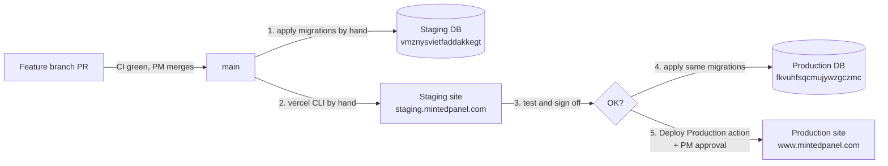

# Staging handoff: GitHub, Vercel, Supabase, domains

For an engineer who needs to get a change onto staging, and later production.

**Facts checked live on October 28, 2026.** IDs and URLs change rarely.
"What is deployed where" changes often. Re-check section 9 before you act.

---

## 1. The short version

- Two code repos. Only `sonny303/mintedpanel` deploys to the web. The Chrome
  extension (`sonny303/minted-extension`) never touches Vercel.
- **Merging to `main` deploys nothing.** `vercel.json` turns Git deploys off.
- **Staging** is its own Vercel project and its own Supabase database. Today it
  is updated **by hand** with the Vercel CLI.
- **Production** is updated by the **Deploy Production** GitHub Action. A human
  starts it. The PM approves it.
- **Database migrations are applied by hand.** Staging first, then production.
  No workflow touches either database.



---

## 2. The map

### Environments

|                        | Staging                                                                                           | Production                                                                             |
| ---------------------- | ------------------------------------------------------------------------------------------------- | -------------------------------------------------------------------------------------- |
| Public URLs            | `staging.mintedpanel.com`, `mintedpanel-staging.vercel.app`, `mintedpanel-staging-web.vercel.app` | `www.mintedpanel.com` (main), `mintedpanel.com` (308 to www), `mintedpanel.vercel.app` |
| Vercel project         | `mintedpanel-staging-web` (`prj_1t7NkRJMkjTuFXEBEP4GjfN4B6Ch`)                                    | `mintedpanel` (`prj_ILhPJbkyaiptdVA8DtsmNyw3tiub`)                                     |
| Vercel deploy type     | **Preview only.** This project has no Production deployments by design.                           | Production                                                                             |
| Supabase project       | `mintedpanel-staging` (`vmznysvietfaddakkegt`, ca-central-1)                                      | `mintedpanel` (`fkvuhfsqcmujywzgczmc`, us-east-2)                                      |
| Git ref                | `staging` branch (a pointer, see section 3)                                                       | `main`                                                                                 |
| How it updates         | Vercel CLI by hand (section 6)                                                                    | **Deploy Production** GitHub Action (section 8)                                        |
| Extension that uses it | Unpacked staging build (section 7)                                                                | Chrome Web Store item `dppfnbikpojpgdiobckgcknmkjlfoinh`                               |

Vercel team: slug `mintedpanel`, id `team_230fpJ9MgCj9ssW3LiIckfyA`.

### Domains and DNS

- `mintedpanel.com` is registered outside Vercel. **DNS is at Squarespace**
  (`nsb1` to `nsb4.squarespacedns.com`). Records there point at Vercel.
- Vercel issues the TLS certificates. Nothing to renew by hand.
- To add a new subdomain: add the record at Squarespace, then add the domain to
  the right Vercel project. Vercel shows the exact record it wants.
- Which deployment a domain shows is set by a Vercel **alias**. Moving an alias
  is how staging goes live (section 6, step 5).

---

## 3. GitHub

### Branches

| Branch          | What it is                                                                                                              |
| --------------- | ----------------------------------------------------------------------------------------------------------------------- |
| `main`          | The only integration branch. **Every PR targets `main`.**                                                               |
| `staging`       | A bookmark for "what should be on staging". Fast-forward only, to a SHA already on `main`. **Never open a PR into it.** |
| everything else | Feature branches (`claude/*`, `cursor/*`, `codex/*`, `feat/*`, `fix/*`, people's names).                                |

**Gotcha:** the `staging` branch does not deploy anything, and nothing keeps it
in sync with the site. Today it points at `255f85a`, but the staging site runs
`a5aceef`. Trust Vercel (section 9), not the branch.

### Merge rules

- PR to `main`, CI green, the PM merges (or says in writing that you may).
- No self-merge. Full rules: [`repo-workflow.md`](repo-workflow.md) and
  [`AGENTS.md`](../../AGENTS.md).
- Cross-repo `/api` changes go panel first, then the extension mirrors
  `src/shared/apiTypes.ts`.

### Workflows (`.github/workflows/`)

| Workflow                 | Trigger                  | Use it?                                                                                                                        |
| ------------------------ | ------------------------ | ------------------------------------------------------------------------------------------------------------------------------ |
| `ci.yml`                 | every PR, push to `main` | Yes, automatic. Lint, typecheck, tests, build, migration dry-run, release guardrails, Playwright smoke. Docs-only PRs skip it. |
| `deploy-production.yml`  | manual                   | **Yes. This is the real production deploy.** See section 8.                                                                    |
| `staging-delivery.yml`   | manual                   | **No.** Built but blocked on purpose (`HOSTED_ACTIVATION_BLOCKED`). All 3 runs so far failed by design.                        |
| `production-release.yml` | manual                   | **No.** Same blocked controller.                                                                                               |
| `scheduled-backup.yml`   | nightly                  | Automatic repo backup. Nothing to do.                                                                                          |

---

## 4. Vercel

### Settings that matter

- `vercel.json` has `git.deploymentEnabled: false`. Pushing to any branch that
  carries this file creates no deployment. A CI test fails if anyone changes it.
- `vercel.json` `build.env` also sets `VITE_MINTED_EXTENSION_ID` (the Store ID),
  `VITE_ENABLE_EXACT_WORK_V2=true` and `NITRO_PRESET=vercel`. **A local
  `vercel build` ignores `build.env`.** That is why the deploy commands below
  pass these in the shell.
- The production project is still linked to GitHub. A branch **without**
  `vercel.json` can still trigger a Preview build there (an asset-only branch did
  on Oct 20 and errored). Harmless, but don't be surprised by it.
- **Staging has Vercel Authentication on** (setting: all deployments except
  custom domains). Raw `*.vercel.app` deployment URLs ask for a Vercel login.
  Testers outside the team need a shareable link from the Vercel dashboard.

### Environment variables (names only)

Staging project, all **Preview** target:

| Name                                                            | What                                                                     |
| --------------------------------------------------------------- | ------------------------------------------------------------------------ |
| `VITE_SUPABASE_URL`, `VITE_SUPABASE_ANON_KEY`                   | Browser client, staging Supabase                                         |
| `SUPABASE_URL`, `SUPABASE_ANON_KEY`, `SUPABASE_PUBLISHABLE_KEY` | Server client, staging Supabase                                          |
| `SUPABASE_SERVICE_ROLE_KEY`                                     | Server `/api` routes. Sensitive.                                         |
| `API_CORS_ORIGINS`                                              | Staging web origins + `chrome-extension://` IDs of the staging extension |
| `VITE_MINTED_EXTENSION_ID`                                      | Staging unpacked extension ID (`fiifegmlnljiimlebiokbbefjndhjmih` today) |
| `DANGEROUSLY_DEPLOY_VULNERABLE_TANSTACK_START_XSS`              | Build flag the framework requires                                        |

Not on staging yet: `SENDGRID_API_KEY`, `SENDGRID_FROM_EMAIL`,
`SENDGRID_FROM_NAME`, `SENDGRID_SANDBOX`, `APP_BASE_URL`. The provider intake
invite emails on `main` need them (see section 10).

Production project: the same core names on the **Production** target, plus
`POSTGRES_*` and `NEXT_PUBLIC_SUPABASE_*` from the Vercel Supabase integration.
It also still has some **Preview** variables scoped to Git branch `staging`
that point at the staging database. Those are left over from when staging
lived inside the production project. Nothing uses them now. Ask the PM before
deleting.

**Rule:** a variable change only reaches the **next** deployment. Change it,
then redeploy.

---

## 5. Supabase

- Migrations live only in `mintedpanel/supabase/migrations/`.
- They are applied **by hand** with the Supabase MCP `apply_migration` tool.
  Do not paste schema changes into the SQL editor.
- **Staging first.** Production only at release time (section 8).
- **Additive only.** No drops. Anything destructive needs PM sign-off.
- **Verify the object, not the filename.** The ledger stores its own version
  numbers, so `list_migrations` won't match the filenames. Query the actual
  table, column, constraint or function instead. Recipes: the
  `supabase-migrations` skill (`.claude/skills/supabase-migrations/SKILL.md`).
- Some repo migrations wait on PM sign-off and must never be agent-applied.
  The list is in `CLAUDE.md`, section "Repo-only migrations awaiting an operator
  apply".

---

## 6. Runbook: get a change onto staging

One-time setup: Node 22, `npx vercel login` as a member of the `mintedpanel`
team, access to Supabase (MCP or dashboard), GitHub write.

**Step 0. Merged.** The change is on `main` with green CI.

**Step 1. Clean checkout of the exact SHA.** Use a fresh clone, not your
working folder. The Oct 20 deploy uploaded local build folders because there is
no `.vercelignore`.

```sh
git clone https://github.com/sonny303/mintedpanel.git mp-staging && cd mp-staging
git checkout --detach origin/main        # or a specific SHA
SHA=$(git rev-parse HEAD); echo "$SHA"
```

**Step 2. Database first.** List new migrations since the SHA staging runs now
(section 9):

```sh
git diff --name-only <SHA_ON_STAGING_NOW> "$SHA" -- supabase/migrations
```

Apply each to **`vmznysvietfaddakkegt`**, in filename order. Verify each object.

**Step 3. New env vars.** If the change reads a new variable, add it to the
staging project (Preview target) now.

**Step 4. Build and deploy.** This mirrors `deploy-production.yml`, but targets
the staging project as a Preview.

```sh
export VERCEL_ORG_ID=team_230fpJ9MgCj9ssW3LiIckfyA
export VERCEL_PROJECT_ID=prj_1t7NkRJMkjTuFXEBEP4GjfN4B6Ch   # STAGING. Double-check.
STAGING_EXT_ID=fiifegmlnljiimlebiokbbefjndhjmih             # = staging VITE_MINTED_EXTENSION_ID

npm ci
npx vercel pull --yes --environment=preview
VITE_MINTED_EXTENSION_ID=$STAGING_EXT_ID VITE_ENABLE_EXACT_WORK_V2=true \
  NITRO_PRESET=vercel VERCEL=1 npx vercel build

# Stop if either check prints nothing.
grep -rlF "$STAGING_EXT_ID" .vercel/output/static/assets | head -1
grep -rlF "The exact case step context is incomplete" .vercel/output/static/assets | head -1

npx vercel deploy --prebuilt --meta sourceSha="$SHA"
```

Never add `--prod`. Never run this with the production project ID.
The last command prints the new deployment URL.

**Step 5. Point the staging domains at it.**

```sh
URL=<deployment url from step 4>
for d in staging.mintedpanel.com mintedpanel-staging.vercel.app mintedpanel-staging-web.vercel.app; do
  npx vercel alias set "$URL" "$d" --scope mintedpanel
done
```

**Step 6. Move the bookmark.** Fast-forward only. If Git rejects it, stop and
ask. Never force.

```sh
git push origin "$SHA":refs/heads/staging
```

**Step 7. Check it.**

- `https://staging.mintedpanel.com/api/health` returns 200.
- Sign in with a staging UAT account. Click through what changed.
- `npx vercel inspect staging.mintedpanel.com --scope mintedpanel` shows your
  deployment.
- Post the SHA, the deployment ID and the migrations you applied in the PR or
  team channel.

**Rollback:** alias the domains back to the previous deployment (step 5 with
the old URL). Find it with `npx vercel ls mintedpanel-staging-web --scope
mintedpanel`. Migrations are additive, so the database stays as is.

---

## 7. The extension against staging

- The extension is a separate repo and never deploys to Vercel. Full steps:
  `minted-extension/docs/release/README.md`.
- Build: `npm run build:staging -- --config staging-public.local`. Load
  `release-artifacts/staging/extension` with **Load unpacked**. It talks to
  `https://staging.mintedpanel.com` and the staging Supabase.
- Chrome gives an unpacked extension an ID based on its folder path. **That ID
  must match the staging project's `VITE_MINTED_EXTENSION_ID` and appear in
  `API_CORS_ORIGINS`.** Allowed today: `fiifegmlnljiimlebiokbbefjndhjmih`
  (current) and `aofljonollgnkbkliabemnnoahcbflpk` (older).
- New folder means new ID. Then update both variables and redeploy staging,
  or "Work in portal" and the extension's API calls will fail.

---

## 8. Production release (after staging sign-off)

1. Apply the same migrations to **`fkvuhfsqcmujywzgczmc`**. Verify each object.
2. Add any new env vars to the production project (Production target).
3. Confirm `main` still equals the SHA you tested on staging:
   `git ls-remote origin refs/heads/main`.
   **The action deploys whatever `main` is when it starts.** It has no SHA
   input. If `main` moved, re-test on staging first.
4. GitHub, Actions, **Deploy Production**, Run workflow on `main`, type
   `deploy`. It waits for the PM's approval (GitHub Environment `Production`).
5. The action builds, deploys with `--prod`, points `www.mintedpanel.com` and
   `mintedpanel.vercel.app` at it, then checks `/api/health`, the home page,
   and that the Store extension ID is in the bundle.
6. Extension Store releases are separate. Use the
   `publish-update-to-chrome-store` skill in the extension repo.

---

## 9. Where things stand (October 28, 2026)

|            | Staging                                         | Production                                   |
| ---------- | ----------------------------------------------- | -------------------------------------------- |
| Site runs  | `a5aceef` (PR #519), deployed Oct 20, 06:10 UTC | `a5aceef`, Deploy Production run #11, Oct 25 |
| Deployment | `dpl_DvfckJu5XYvCBv48YHJNxtrHoEKu`              | `dpl_27MCMJHPrXYqJvrgEbM1PteuM9j3`           |
| Database   | Missing 2 migrations from `main`                | Missing the same 2                           |

`main` and the `staging` branch are both at `255f85a`, 29 commits past
`a5aceef`. The two migrations not yet applied anywhere (checked by object):

| Migration                                                 | Applied when this is true                                                                                     |
| --------------------------------------------------------- | ------------------------------------------------------------------------------------------------------------- |
| `20261021120000_provider_enrollment_letter_documents.sql` | column `provider_documents.payer_id` exists                                                                   |
| `20261025120000_provider_intake_invites.sql`              | function `verify_intake_code` exists; then run `scripts/sql/provider-intake-smoke.sql` (it rolls itself back) |

How to re-check yourself:

- Staging site: `npx vercel inspect staging.mintedpanel.com --scope mintedpanel`
- Production site: the latest successful Deploy Production run, or
  `npx vercel inspect www.mintedpanel.com --scope mintedpanel`
- Database: query the object (section 5)

---

## 10. Known gaps and stale docs

**Gaps worth a PM decision**

1. **No SHA trail on staging.** The Oct 20 deploy carries no commit info. The
   `--meta` flag in step 4 fixes that going forward. A "Deploy Staging" action
   cloned from `deploy-production.yml` would fix it for good.
2. **Production deploys `main`, not a tested SHA.** Adding a `sha` input to
   `deploy-production.yml` would close that.
3. **Provider intake on `main` needs setup before it works anywhere:** the
   intake migration plus `SENDGRID_*` and `APP_BASE_URL` on both Vercel
   projects.
4. **Staging protection and the extension.** Older notes say Vercel
   Authentication blocked the extension's API calls to staging. That was
   before the staging domains moved to the staging project on Oct 16. Re-test
   before you rely on either answer.

**Docs that disagree with reality.** Follow this file for deploys until they
are fixed.

| Doc                                                     | What is out of date                                                                                                                    |
| ------------------------------------------------------- | -------------------------------------------------------------------------------------------------------------------------------------- |
| `.cursor/skills/minted-panel-deploy/SKILL.md`           | Says never run `vercel deploy` and that `production-release.yml` is the path. Production really ships through `deploy-production.yml`. |
| `docs/ops/environment-architecture.md`                  | Its Sept 22 readback says the staging domains belong to the production project. They moved Oct 16.                                     |
| `CLAUDE.md` (Stack section)                             | Calls the staging aliases "intended". They are live.                                                                                   |
| `docs/ops/staging-delivery.md`, `production-release.md` | Describe the blocked controller. Accurate about the design, not how deploys happen today.                                              |

## Related

- [`environment-architecture.md`](environment-architecture.md): diagrams and
  data flows (mind the stale readback above)
- [`repo-workflow.md`](repo-workflow.md): who merges what
- `.claude/skills/supabase-migrations/SKILL.md`: migration workflow
- `docs/VERIFY.md`: what to run before you push
