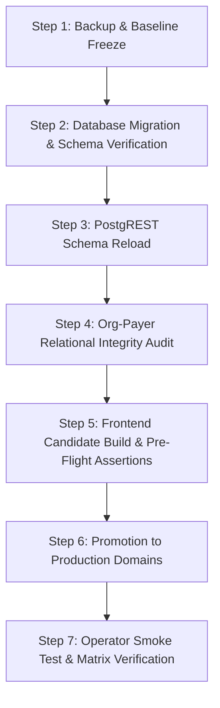

# CF-V1 Staging Deployment: Root Causes, Lessons Learned, and Production Rollout Controls

**Date:** 2026-10-05  
**Release:** CF-V1 (MINT-42, MINT-44, MINT-45, MINT-48, MINT-49, MINT-51, MINT-52, MINT-57, MINT-58, MINT-60)  
**Target Environments:** Staging (`vmznysvietfaddakkegt`) &rarr; Production (`mintedpanel.com`)  
**Scope:** Panel Web Application (`mintedpanel`), Chrome Extension (`minted-extension`), Supabase Database & RPCs

---

## 1. Executive Summary

During the October 2, 2026 staging deployment and subsequent UAT testing (specifically **TC-1.2: Group Contracts Matrix launch for Aetna Contracting**), multiple critical blockers emerged that prevented operators from assigning contract SOPs and executing contracting workflows from the Group Contracts Matrix.

Analysis revealed that these issues stemmed from five distinct vectors:
1. **Database Schema & PostgREST Desynchronization:** Migrations had not been executed sequentially on staging, and PostgREST schema cache had not been invalidated, causing RPC signature mismatches (`42883` / `PGRST202`).
2. **Missing Relational Prerequisite Data:** Staging organizations lacked mandatory rows in `public.org_payer_assignments`, triggering database exception `22023: contract_sop_template_ineligible` during global SOP assignment.
3. **Template Lifecycle Default State:** Duplicating an SOP template in `TemplateWizard` silently set `archived: true`, which caused the Group Contracts Matrix drawer to filter it out as incompatible.
4. **Execution Model & Mental Model Divergence:** Operators attempted to create synthetic `credential_cases` with `case_type = "contract"` in the Cases center, unaware that CF-V1 establishes Contracts as independent root owners (`ownerKind: "contract"`) launched directly from `/reporting/contracts-matrix`.
5. **Migration Sequence Conflicts:** Duplicate migration timestamps existed in historical plans (`20260903210000`), complicating automated migration verification.

This document operationalizes the root causes, corrective actions taken in staging, and the mandatory preventative controls required before promoting CF-V1 to Production.

---

## 2. Root Cause Analysis & Lessons Learned

### Lesson 1: PostgREST Schema Cache & RPC Overload Desynchronization

- **What Happened in Staging:**  
  The updated frontend build called `author_global_sop` with 9 arguments (including `p_case_type`) and `publish_sop_template_version(..., p_case_type)`. The staging database had either not run the latest migration or PostgREST had cached the prior 8-argument signature. Frontend network calls failed with `42883` ("function ... does not exist") and `PGRST202`. Furthermore, 20 sequential migrations (`20261001150100` through `20261007120000_r1_database_schema_sanitization.sql`) had to be compiled and manually applied (`STAGING_CF_V1_ROLLOUT.sql`).
- **Impact:** Complete failure to author, clone, or publish SOP templates from the UI.
- **Production Lesson & Hard Control:**
  1. **Strict Ordering:** Database migrations must complete and report green *before* any production frontend build is built, deployed, or promoted to customer domains.
  2. **Mandatory Cache Reload:** Every database migration script or deployment runner must execute `NOTIFY pgrst, 'reload schema';` immediately after DDL/function creation.
  3. **RPC Pre-Flight Verification:** Before cutting over production traffic, an automated pre-flight query must verify that all expected RPC signatures and parameter counts match the frontend contract.

---

### Lesson 2: Relational Prerequisite Enforcement (`org_payer_assignments`)

- **What Happened in Staging:**  
  When testing TC-1.2, assigning a global SOP to contract `0f18b35d-eef1-4e95-b54b-8dfdc148b9d8` (Aetna &times; NC) under BEST Physical Therapy LLC failed with SQL exception `22023: contract_sop_template_ineligible`.  
  Investigation showed that `assign_contract_sop` enforces the following check:
  ```sql
  IF template.org_id IS NULL THEN
    IF NOT EXISTS (
      SELECT 1 FROM org_payer_assignments
      WHERE org_id = contract.org_id AND payer_id = template.payer_id
    ) THEN
      RAISE EXCEPTION 'contract_sop_template_ineligible' USING ERRCODE = '22023';
    END IF;
  END IF;
  ```
  In staging, BEST Physical Therapy LLC had 0 rows in `public.org_payer_assignments`.
- **Impact:** Global contract SOPs could not be bound to contracts, silently aborting matrix setup.
- **Production Lesson & Hard Control:**
  1. **Pre-Flight Data Integrity Audit:** Production databases must be audited prior to release to identify organizations that lack active payer assignments for participating payers.
  2. **Atomic Onboarding:** Org creation and payer-linking pipelines must guarantee that `org_payer_assignments` records are populated automatically whenever a payer contract or credentialing case is initiated.
  3. **UI Error Granularity:** If an unassigned payer is selected, the UI must explain that the organization lacks an active payer attachment rather than failing silently.

---

### Lesson 3: Template Duplication Lifecycle (`archived: true`)

- **What Happened in Staging:**  
  When an operator duplicated an existing SOP (e.g., `Aetna - Direct`), the backend set `archived = true` by default. In `ContractSopAssignmentPanel.tsx`, `compatibleContractSops()` strictly filtered out archived templates:
  ```typescript
  const compatible = templates.filter(t => !t.archived && ...);
  ```
  The newly cloned template appeared to "vanish", leading operators to believe the duplicate action failed.
- **Impact:** Operators could not select the newly duplicated SOP in the Group Contracts Matrix until manually unarchived in the database (`UPDATE public.sop_templates SET archived = false WHERE id = ...`).
- **Production Lesson & Hard Control:**
  1. **UI Transparency:** The SOP library and Matrix drawer must clearly indicate whether a template is `Draft`, `Active`, or `Archived`.
  2. **Operator Workflow Documentation:** Operator training must highlight that duplicated templates are created in an archived/draft state and require an explicit "Activate" action before being assignable.

---

### Lesson 4: Mental Model Divergence (Contracting Matrix vs. Credentialing Cases)

- **What Happened in Staging:**  
  Operators spent significant time looking for or trying to create a "credential case with case type = contract" in the Cases center, expecting contracting workflows to launch from a case detail page.  
  Under CF-V1 (MINT-44 / MINT-49):
  - **Credentialing & Enrollment:** Uses `ownerKind: "case"`. Tracked in `credential_cases`, assigned to an individual provider, launched from the Cases dashboard.
  - **Payer Group Contracting:** Uses `ownerKind: "contract"`. Tracked in `group_contracts`, launched exclusively from the **Group Contracts Matrix** (`/reporting/contracts-matrix`). Providers and practice locations are **runtime execution parameters** chosen in the launch drawer, not persistent case entities.
- **Impact:** User confusion, perceived bugs, and blocked testing because operators looked in the wrong UI surface.
- **Production Lesson & Hard Control:**
  1. **Release Notes & User Guidance:** Release notes and UAT scripts must clearly delineate the two operational paths.
  2. **In-App Navigation:** Add contextual deep-links in the Cases center ("Need to execute Group Contracting? Open Group Contracts Matrix") and vice-versa.

---

### Lesson 5: Migration Plan Integrity & Version Collisions

- **What Happened in Staging:**  
  The migration history had a duplicate version timestamp (`20260903210000`) in `scripts/migrations/plans/production.json`, blocking automated migration reconciliation. In addition, migrations were fragmented across individual feature branches rather than packaged in a single deterministic rollout bundle.
- **Impact:** Staging required manual ad-hoc consolidation (`STAGING_CF_V1_ROLLOUT.sql`) to recover.
- **Production Lesson & Hard Control:**
  1. **Deduplicate Timestamps:** Reconcile `scripts/migrations/plans/production.json` so every migration file has a unique monotonically increasing timestamp.
  2. **Deterministic Manifest:** Use a verified migration manifest where every file's SHA-256 hash is validated before execution.
  3. **No Drift:** Never apply manual SQL fixes in production without checking them into version control and recording them in `supabase_migrations`.

---

### Lesson 6: PostgREST Parameter Overloading and RPC Defaults (`propose_shared_field_map`)

- **What Happened in Staging & Production:**  
  When an operator captured form fields in the Workbench extension and clicked **Send for approval**, the backend API route `POST /api/shared-field-maps` invoked the RPC `propose_shared_field_map`. The database had two conflicting versions: a legacy 10-argument version and an 11-argument version lacking SQL `DEFAULT` clauses for optional parameters (`p_notes`, `p_map_type`, `p_expected_mapping_generation`). Because the extension omitted optional arguments, PostgREST could not match the signature in its schema cache (`PGRST202`), causing the Vercel API handler to return `500 Internal server error`.
- **Impact:** Blocked operators from submitting captured web/payer form fields for approval, which in turn prevented field mapping approval, proving the form, and unlocking **Work in portal** in the Group Contracts Matrix.
- **Production Lesson & Hard Control:**
  1. **Drop Legacy Overloads:** Explicitly drop prior function signatures (`DROP FUNCTION IF EXISTS ...`) when expanding RPC signatures so PostgREST resolves deterministically.
  2. **Mandatory Defaults for Optional Parameters:** Any stored procedure called by frontend or extension clients where fields are optional must define explicit SQL `DEFAULT` clauses (e.g., `p_notes text DEFAULT '...'`, `p_map_type text DEFAULT 'web'`).
  3. **Automated Schema Reload:** Always invoke `NOTIFY pgrst, 'reload schema';` whenever function definitions are altered.

---

## 3. Production Deployment Protocol & Pre-Flight Gates

To ensure a smooth, zero-downtime production rollout, the following checklist must be satisfied in order:



### Pre-Deployment Verification Checklist

| Step | Action | Command / Query / Criterion | Gatekeeper |
| :--- | :--- | :--- | :--- |
| **G-01** | Production Database Backup | Verified snapshot age $\le 24$ hours; demonstrated restore $\le 4$ hours. | DevOps / DBA |
| **G-02** | Migration Reconciliation | Resolve duplicate `20260903210000` in `production.json`. Verify sequential plan. | Release Lead |
| **G-03** | Run Migrations | Execute sequential CF-V1 migration suite (`20261001150100` through `20261007120000`). | Supabase CLI / CI |
| **G-04** | PostgREST Cache Invalidation | Execute `NOTIFY pgrst, 'reload schema';` on production database. | Automated Migration Hook |
| **G-05** | RPC Signature Verification | Assert `author_global_sop` (9 args), `publish_sop_template_version`, `assign_contract_sop`, `reset_portal_form_mapping_atomic` exist. | Pre-flight SQL Check |
| **G-06** | Org-Payer Dependency Audit | Verify all active organizations have corresponding rows in `org_payer_assignments` for all active payers. | Pre-flight SQL Check |
| **G-07** | Build Panel & Extension | Build candidate with `--skip-domain`. Verify MV3 hash and Panel SHA match tested staging artifacts. | Vercel & GitHub Actions |
| **G-08** | Boundary Enforcement | Verify all 6 blockers in `scripts/delivery/boundary.mjs` are cleared with authenticated evidence. | Release Approver (`261707544`) |
| **G-09** | Production Domain Promotion | Promote candidate to `mintedpanel.com`, `www.mintedpanel.com`, `mintedpanel.vercel.app`. | Release Controller |
| **G-10** | Post-Deploy UAT Smoke | Run TC-1.1 (Enrollment) and TC-1.2 (Contracting) in production using dedicated test entities. | UAT Lead |

---

## 4. Key Pre-Flight SQL Queries for Production

### A. PostgREST Schema Reload
```sql
NOTIFY pgrst, 'reload schema';
```

### B. Verify RPC Signatures
```sql
SELECT 
    routine_name, 
    COUNT(parameter_name) AS param_count
FROM information_schema.parameters
WHERE specific_schema = 'public'
  AND routine_name IN ('author_global_sop', 'publish_sop_template_version', 'assign_contract_sop', 'reset_portal_form_mapping_atomic')
GROUP BY routine_name;
-- Expected:
-- author_global_sop: 9 parameters (including p_case_type)
-- publish_sop_template_version: includes p_case_type
-- assign_contract_sop: present and active
-- reset_portal_form_mapping_atomic: present and active
```

### C. Detect Organizations Missing Payer Assignments
```sql
SELECT o.id, o.name 
FROM organizations o
WHERE NOT EXISTS (
    SELECT 1 
    FROM org_payer_assignments opa 
    WHERE opa.org_id = o.id
);
-- Action: If any active organizations are returned, seed active org_payer_assignments for their supported payers.
```

### D. Verify Active SOP Template Status
```sql
SELECT id, name, payer_id, case_type, archived, current_version
FROM public.sop_templates
WHERE archived = false
ORDER BY name;
-- Action: Ensure production templates intended for Group Contracts Matrix are NOT marked archived = true.
```

---

## 5. Safety & Human Oversight Guarantees

In accordance with HIPAA compliance and legal attestation guardrails:
1. **Pre-Submit Review Hard Stop:** The extension strictly halts execution on the final review page. No automation is permitted to click final submission buttons on payer portals (Aetna, Optum, etc.).
2. **Attestation Independence:** Accuracy checkboxes, perjury declarations, and email consent radio buttons must remain operator-driven; the extension must not auto-populate or check these controls.
3. **Data Loss Prevention:** Form mapping resets must strictly use the atomic RPC (`reset_portal_form_mapping_atomic`) to write append-only receipts, preserving historical auditability and tenant isolation.

---

## 6. Sign-off & Document Lineage

- **Authored By:** Deployment & Verification Engineering Pair
- **References:**
  - Consolidated Migration Suite: `STAGING_CF_V1_ROLLOUT.sql`
  - Delivery Boundary Controller: `mintedpanel/scripts/delivery/boundary.mjs`
  - Production Migration Plan: `mintedpanel/scripts/migrations/plans/production.json`
  - Rollout Runbook Draft: `review-artifacts/cf-v1-rollout-runbook-draft.md`
